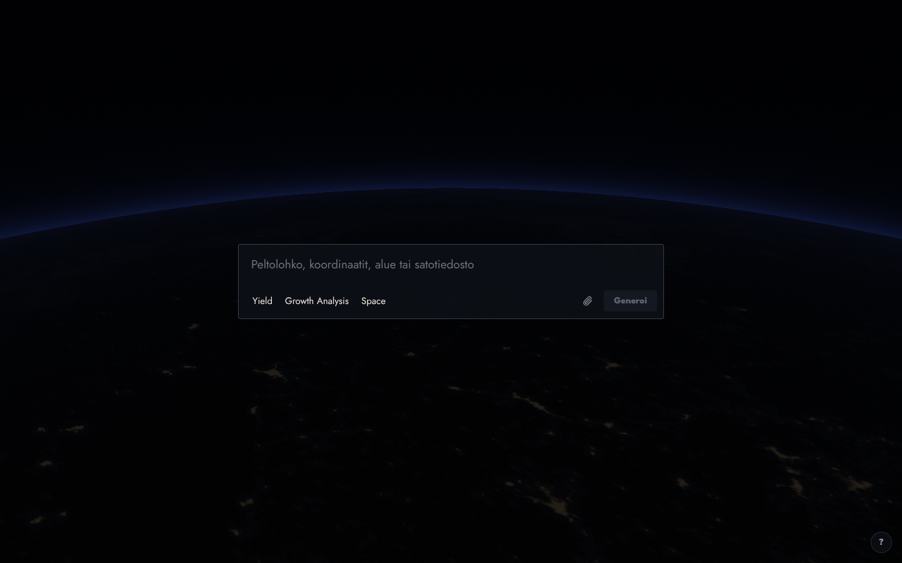
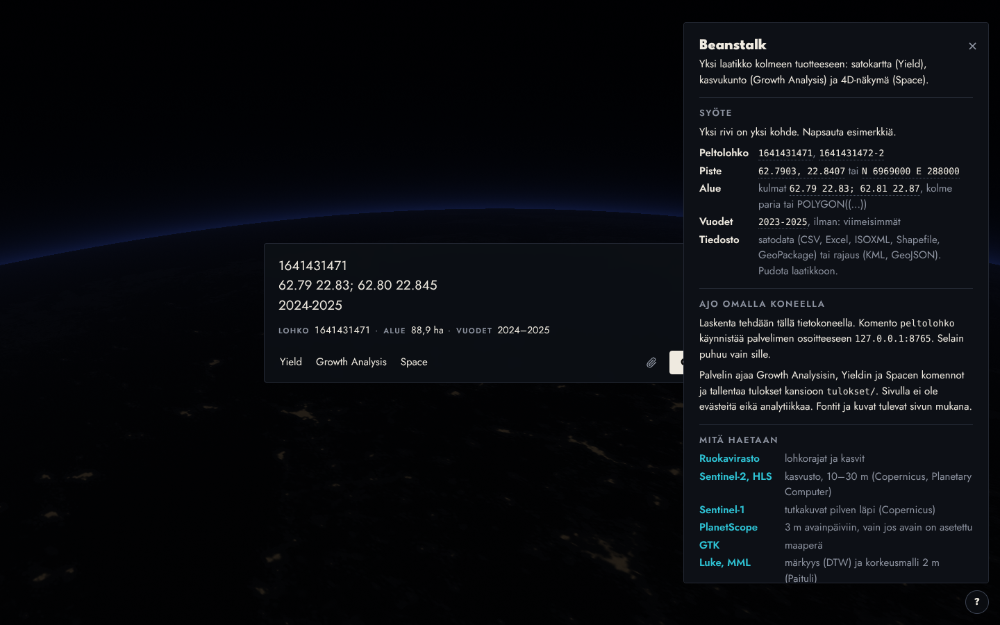
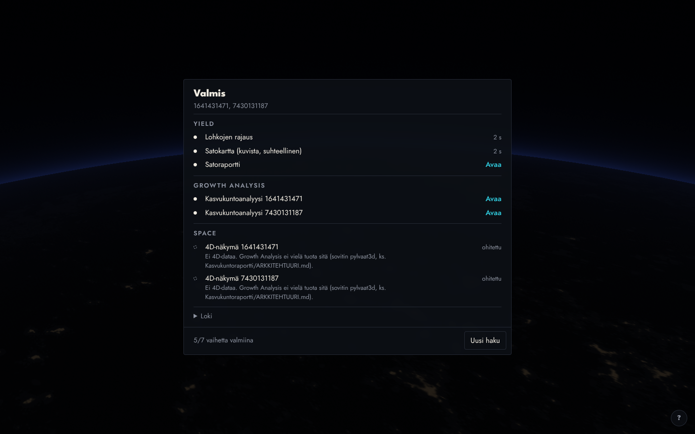

# Peltolohko: Beanstalkin etusivu

Etusivu ja käynnistin, joka vie yhdestä syöttölaatikosta Beanstalkin kolmeen tuotteeseen:
**Beanstalk Yield** (satokartta), **Beanstalk Growth Analysis** (kasvukuntoanalyysi) ja **Beanstalk Space**
(4D-näkymä).



Ilme on Signaali ([joriim/oma-design](https://github.com/joriim/oma-design): `tokens/varit.css`,
League Spartan ja Jost) mahdollisimman pelkistettynä. Tausta on musta maapallo läheltä: noin 300 km
korkeudelta Selkämeren yltä koilliseen, horisontti ylhäällä ja yövalot (NASA Black Marble) niin himmeinä,
että ne tuskin erottuvat. Kuva piirretään kerran WebGL:llä; se ei liiku eikä reagoi mihinkään. Sivulla on
vain syöttölaatikko ja alanurkassa **?**, joka kertoo syötteen muodot, mitä tietolähteitä haetaan, mitä
koneelta lähtee ja miten ohjelma ajetaan omalla koneella.

Joskus taustan edestä kulkee leijona, tiikeri tai karhu, kuten Beanstalk Spacessa: ensimmäinen
1–3 minuutin kuluttua, sitten 3–8 minuutin välein. Ne ovat niin lähellä ja sumeita, ettei lajia
tunnista. Joka neljäs pysähtyy laidalle ja tuijottaa hetken, jolloin silmät syttyvät. Ne eivät reagoi
käyttäjään eikä niitä selitetä sivulla. "Vähennä liikettä" -asetuksella ne ovat pois. Kokeilu:
`?elaimet=heti`, `?elaimet=tuijotus` tai `?elaimet=terava` (ilman sumeutta).



## Syöte

Laatikkoon voi kirjoittaa, liittää tai pudottaa. Yksi rivi on yksi kohde.

| Syöte | Esimerkki |
|---|---|
| peltolohkonumero, yksi tai useampi | `1641431471`, `1641431471, 1641431472-2`, `164 143 1471` |
| piste, WGS84 | `62.7903, 22.8407` · `62,79 22,84` · `62°47'N 22°50'E` |
| piste, ETRS-TM35FIN | `N 6969000 E 288000` |
| alue: kaksi kulmaa | `62.79 22.83; 62.81 22.87` |
| alue: monikulmio | kolme tai useampi pari rivillä, `POLYGON((…))` tai GeoJSON |
| satotiedosto | CSV/TXT, Excel, ISOXML (zip), Shapefile (zip), GeoPackage, pistemuotoinen GeoJSON |
| vuodet, omalla rivillään | `2023-2025`, `2024, 2025` (ilman: viimeisimmät) |
| rajaus | KML tai monikulmio-GeoJSON |

Koordinaatiston ja järjestyksen (lat/lon vai lon/lat, N/E vai E/N) sivu päättelee arvoista. Pisteet ja
alueet muutetaan peltolohkonumeroiksi Ruokaviraston lohkorekisteristä (uusin peruslohkotaso,
`Intersects`-haku). Tunnistetut kohteet näkyvät laatikossa siruina jo kirjoitettaessa.

Tuotenapeista valitaan, mitä generoidaan. Ilman vuosiriviä Growth Analysis käyttää omaa oletustaan ja
Yield viimeisintä satokautta.

## Mitä ajossa tapahtuu



| Tuote | Vaiheet | Tulos |
|---|---|---|
| Growth Analysis | `kasvukunto analysoi <lohko>` jokaiselle lohkolle | HTML-raportti / lohko |
| Space | analyysin 4D-näkymädata varastosta → `beanstalk4d nayta` | katselin / lohko |
| Yield | `yieldsuite parcel` (rajaus) → `yieldsuite inspect` (jokainen satotiedosto) → `field.yaml` → `yieldsuite run --to L4` → `yieldsuite report` | satoraportti |

Yield tarvitsee puimurin satotiedoston: ilman sitä vaihe ohitetaan, koska pelkistä kuvista tehtävää
suhteellista karttaa Yieldissä ei vielä ole. Ajo tekee L4-tason satoruudukon ja raportin; kuvafuusio (L5)
vaatii openEO-tunnuksen ja ajetaan erikseen. Valmiit tulokset avautuvat ajonäkymän *Avaa*-linkeistä, ja ajon loki on
saman näkymän alla.

**Space odottaa sovitinta.** Growth Analysis ei vielä kirjoita 4D-näkymän dataa: sovitin `pylvaat3d` on
suunniteltu Kasvukuntoraporttiin (ks. `Kasvukuntoraportti/ARKKITEHTUURI.md`). Siihen asti Space-vaihe
etsii dataa varastosta (`space*.json`, `nakyma*.json`, `*4d*.json` lohkon kansiossa) ja ohittaa lohkon
syyn kertoen, jos dataa ei ole.

## Käyttö

```bash
pip install -e .                                   # etusivu (vain standardikirjasto)
pip install -e ../Beanstalk-Growth-Analysis        # kasvukunto
pip install -e ../Beanstalk-Space                  # beanstalk4d
pip install -e "../Beanstalk-Yield[geo]"           # yieldsuite
peltolohko                                         # avaa http://127.0.0.1:8765/
```

Tunnukset (CDSE, Planet ym.) asetetaan kuten kunkin työkalun ohjeissa. Puuttuva työkalu ei kaada ajoa:
sen vaihe merkitään virheeksi asennusohjeen kanssa.

`peltolohko tulkitse "62.79, 22.84"` näyttää, miten syöte tulkitaan.

### NAS tai muu palvelin

Docker-kontti, jossa sivu ja kaikki kolme työkalua: [nas/README.md](nas/README.md) (QNAP TS-253D,
Container Station). Kun palvelin näkyy verkkoon (`--osoite 0.0.0.0`), aseta kirjautuminen
ympäristömuuttujilla `PELTOLOHKO_SALASANA` (ja valinnaisesti `PELTOLOHKO_KAYTTAJA`, oletus `beanstalk`).
Ajot ajetaan jonossa yksi kerrallaan (`rinnakkaiset_ajot` asetuksissa). `GET /api/tila` vastaa ilman
kirjautumista terveystarkistukselle.

### Asetukset

Valinnainen `peltolohko.toml` työhakemistossa (tai `--asetukset polku`):

```toml
varasto = "/data/kasvukunto-varasto"

[komennot]
growth = ["kasvukunto", "analysoi", "{tunnus}", "--varasto", "{varasto}",
          "--raportti", "{kansio}/growth/{tunnus}.html", "{vuodet_arg}", "--ilman-vertailua"]

space_data = ["{varasto}/{peruslohko}*/**/space*.json"]
```

Mallien paikat: `{tunnus}`, `{peruslohko}`, `{varasto}`, `{kansio}` (ajon kansio), `{vuodet}`,
`{vuodet_arg}` (`--vuodet …` tai ei mitään), `{lohkot}`, `{tiedosto}`, `{taso}`, `{data}`.

## Rakenne

```
src/peltolohko/
  data/etusivu.html   etusivu: tausta (WebGL), syöttölaatikko, ajonäkymä
  data/valot.jpg      yövalot 0–50° E, 50–76° N (NASA Black Marble)
  syote.py            tekstin ja tiedostojen tulkinta
  koordinaatit.py     WGS84 <-> ETRS-TM35FIN ilman pyprojia
  rekisteri.py        pisteet ja alueet peltolohkoiksi (Ruokaviraston WFS)
  ajot.py             vaiheet ja komennot, taustasäikeet
  palvelin.py         paikallinen HTTP-palvelin (127.0.0.1)
  cli.py              peltolohko-komento
```

Palvelin kuuntelee oletuksena vain omaa konetta, koska se käynnistää komentoja. Verkkoon avattuna se
varoittaa, jos salasanaa ei ole asetettu. Testit: `pytest`
(työkalut korvataan testeissä tynkäkomennoilla, lohkorekisteri valerekisterillä).
